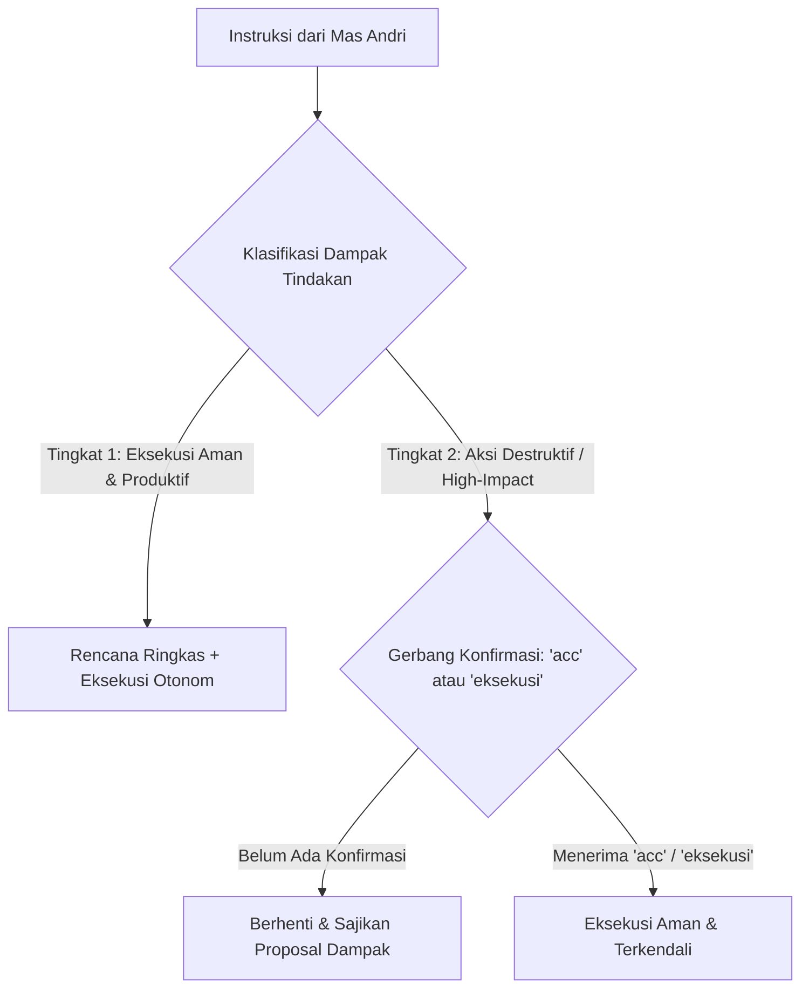

# CONFIRMATION GATE & EXECUTION LIFECYCLE
## Protokol Gerbang Konfirmasi & Tata Kelola Aksi Eksekusi Solo Fullstack
### Keseimbangan Antara Kecepatan Otonom (Velocity) & Keamanan Sistem (Safety)

> [!IMPORTANT]
> Aturan ini dirancang khusus untuk **Andricha Dea Mitra (Andri)** guna memaksimalkan kecepatan pengembangan (*developer velocity*) tanpa mengorbankan integritas sistem dan keamanan basis data.

---

## 1. Klasifikasi Tingkat Eksekusi (Two-Tier Execution Gate)

---

### Tingkat 1: Eksekusi Mandiri Cepat (Safe Autonomous Velocity)
Agent berwenang merencanakan dan **langsung mengeksekusi** penulisan kode jika instruksi sudah jelas dan mencakup:
1. Pembuatan komponen antarmuka baru (UI / React / Next.js).
2. Penambahan rute, controller, DTO, atau service backend baru.
3. Penambahan model Prisma atau migrasi non-destruktif (*additive migrations*).
4. Perbaikan bug (*bugfix*), linting, atau penulisan unit test.
5. Konfigurasi build dan styling CSS / Tailwind.

*Syarat Eksekusi:*
- Agent menyajikan rencana singkat (3-5 butir) di awal respons.
- Mendeklarasikan skill aktif dari `.agents/skills/`.
- Langsung menjalankan eksekusi dan memverifikasi hasilnya tanpa membuang waktu Mas Andri.

---

### Tingkat 2: Gerbang Konfirmasi Wajib (Destructive & High-Impact Gate)
Agent **DILARANG KERAS** mengeksekusi tindakan berikut **SEBELUM** menerima konfirmasi eksplisit dengan salah satu kata kunci:
- **`acc`**
- **`eksekusi`**

Aksi yang wajib menempuh gerbang konfirmasi:
1. **Penghapusan Berkas / Direktori:** Menghapus berkas kode inti atau modul proyek.
2. **Operasi Basis Data Destruktif:** `prisma migrate reset`, `DROP TABLE`, `DROP DATABASE`, atau truncate data produksi/pengujian penting.
3. **Breaking Architectural Changes:** Perubahan radikal struktur folder atau penggantian framework utama.
4. **Instruksi Khusus "Rancang / Review Dulu":** Jika Mas Andri meminta "buatkan rancangan", "analisis dulu", atau "review dulu", Agent wajib tetap dalam mode *READ & PLAN ONLY* hingga Mas Andri mengetikkan `acc` atau `eksekusi`.

---

## 2. Siklus 6-Tahap Pengembangan Modul & Endpoint

Setiap pembuatan modul fullstack terpadu mengikuti alur terstruktur:

1. **Discovery & Requirement Mapping:** Petakan kebutuhan fitur, DTO input, dan visual antarmuka.
2. **Contract & Schema Design:** Rumuskan tipe TypeScript, validasi Zod/class-validator, dan model database.
3. **Database Layer:** Terapkan skema pada Prisma, buat migrasi SQL idempotent, dan update Prisma Client.
4. **Backend Implementation:** Bangun service bisnis terisolasi, controller, dan middleware keamanan.
5. **Frontend Integration:** Bangun antarmuka pengguna responsif yang mengonsumsi endpoint secara type-safe.
6. **Automated Verification:** Jalankan typecheck dan pengujian otomatis untuk memastikan tidak ada regresi.
