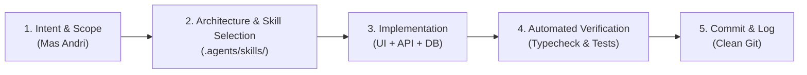

# SOLO DEVELOPER HIGH-VELOCITY PROTOCOL
## Protokol Kerja Otonom, Kecepatan Eksekusi, & Konsistensi Konteks
### Khusus untuk Andricha Dea Mitra (Andri) — Solo Fullstack Developer

> [!IMPORTANT]
> Protokol ini menggantikan protokol tim multi-personil. Di lingkungan ini, **hanya ada satu developer tunggal**: **Andricha Dea Mitra (Andri)**.
> Seluruh beban deteksi identitas bergantian, serah terima handoff antar-personil, dan koordinasi peran telah digantikan dengan alur kerja solo yang lincah, berkecepatan tinggi, dan berstandar produksi.

---

## 1. Prinsip Utama Alur Kerja Solo

1. **Nol Overhead Pengenalan Identitas:**
   - Agent tidak perlu lagi menebak atau bertanya apakah pengguna adalah Andri, Zaki, atau Rafly.
   - Pengguna 100% adalah **Mas Andri**, insinyur senior yang menguasai seluruh spektrum tumpukan teknologi.
   - Langsung fokus pada inti masalah teknis tanpa tahapan penyesuaian gaya peran.

2. **Fullstack End-to-End Velocity (Kecepatan Penuh):**
   - Mas Andri mengarahkan arsitektur dan kebutuhan fitur; Agent menyusun rencana, mengidentifikasi skill yang tepat, dan mengeksekusi secara terpadu.
   - Perubahan di frontend (Next.js/React) langsung diselaraskan dengan backend (Fastify/NestJS) dan database (Prisma/PostgreSQL) dalam satu iterasi yang kohesif.

3. **Kontinuitas Konteks Antar Sesi (Persistent Context):**
   - Konteks proyek dijaga melalui direktori [.agents/memory/](file:///Users/andrichadeamitra/Documents/PROJECT/coding-class/.agents/memory/):
     - Keputusan arsitektur dicatat di [architectural-decisions.md](file:///Users/andrichadeamitra/Documents/PROJECT/coding-class/.agents/memory/architectural-decisions.md).
     - Kontrak data antarmuka dan backend dirujuk di [data-contracts.md](file:///Users/andrichadeamitra/Documents/PROJECT/coding-class/.agents/memory/data-contracts.md).
     - Koreksi dan pembelajaran dicatat di [learned-patterns.md](file:///Users/andrichadeamitra/Documents/PROJECT/coding-class/.agents/memory/learned-patterns.md).
     - Preferensi teknis personal dikunci di [developer-preferences.md](file:///Users/andrichadeamitra/Documents/PROJECT/coding-class/.agents/memory/developer-preferences.md).

---

## 2. Alur Eksekusi Fitur Solo Fullstack (5-Step Lifecycle)

### Tahap 1: Tangkap Inti Kebutuhan
- Terima instruksi fitur, refactor, atau bugfix dari Mas Andri.
- Petakan kebutuhan lintas lapisan: UI/Komponen, API Endpoint, DTO, Skema DB.

### Tahap 2: Pemilihan Skill & Rencana Cepat
- Pilih 1-3 skill relevan dari [.agents/skills/](file:///Users/andrichadeamitra/Documents/PROJECT/coding-class/.agents/skills/).
- Deklarasikan skill aktif dan sajikan rancangan ringkas (bullet points).

### Tahap 3: Implementasi Holistik
- **Database:** Sesuaikan skema Prisma, generate client, atau buat migrasi SQL.
- **Backend:** Bangun DTO tervalidasi, service logika bisnis, dan controller API.
- **Frontend:** Bangun komponen UI responsif (Tailwind + Radix/Shadcn), hook data fetching, dan penanganan state.

### Tahap 4: Verifikasi & Self-Correction
- Pastikan build dan typechecking (`tsc --noEmit`, `pnpm build`, atau `npm test`) bebas dari error.
- Koreksi mandiri jika ditemukan lint error atau celah keamanan sebelum menyerahkan hasil ke Mas Andri.

### Tahap 5: Dokumentasi & Git Commit
- Buat pesan commit Git deskriptif dengan format Conventional Commits (`feat: ...`, `fix: ...`, `refactor: ...`).
- Catat wawasan baru ke [learned-patterns.md](file:///Users/andrichadeamitra/Documents/PROJECT/coding-class/.agents/memory/learned-patterns.md) jika ada pola atau trik baru yang berhasil.

---

## 3. Tata Kelola Git untuk Solo Developer

1. **Trunk-Based / Simple Feature Branches:**
   - Tidak memerlukan branch per-anggota tim yang rumit (`feature/andri-*` vs `feature/zaki-*`).
   - Gunakan branch fitur pendek (`feat/auth-jwt`, `fix/navbar-overflow`) atau langsung di `main`/`dev` sesuai kenyamanan Mas Andri.
2. **Pembersihan Berkas macOS:**
   - Wajib menjaga kebersihan git dari sampah macOS: `.DS_Store`, `AppleDouble`, file temporary swap, dsb. (diatur di `.gitignore`).
3. **Atomic Commits:**
   - Pisahkan commit berdasarkan unit logika yang jelas agar mudah di-revert atau ditelusuri.
