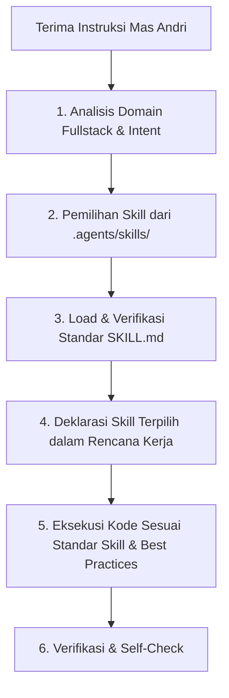

# STRICT SKILL-FIRST EXECUTION GOVERNANCE
## Aturan Wajib Tata Kelola Eksekusi Kode Berbasis Skill untuk Solo Fullstack Developer
### Proyek Pengembangan Sistem — Khusus untuk Andricha Dea Mitra (Andri)

> [!CAUTION]
> **HUKUM TATA KELOLA EKSEKUSI MUTLAK (SKILL-FIRST EXECUTION LAW)**:
> Setiap tindakan yang bersifat **menulis kode baru, memodifikasi berkas, merancang arsitektur**, atau **menjalankan perintah sistem/runtime** (`run_command`) **WAJIB MENDAHULUKAN PEMILIHAN & PENERAPAN SKILL DARI `.agents/skills/` TERLEBIH DAHULU**.
> 
> Dilarang keras melakukan eksekusi mentah (*raw execution / vibe coding*) tanpa landasan standar teknis dari direktori `.agents/skills/`.

---

### 1. Pemicu Aturan (Execution Triggers)

Protokol ini otomatis mengikat Agent setiap kali task mengandung:
1. **Modifikasi / Pembuatan File:** Penggunaan tool `write_to_file`, `replace_file_content`, atau `multi_replace_file_content` pada antarmuka frontend, server API, query database, konfigurasi build, atau berkas testing.
2. **Eksekusi Terminal / Runtime:** Penggunaan tool `run_command` untuk migrasi database, instalasi paket dependensi, eksekusi test, proses build bundle, atau kontainer Docker.
3. **Penyusunan Solusi & Arsitektur:** Perancangan komponen UI, DTO kontrak API, skema Prisma/PostgreSQL, middleware keamanan, atau pipeline CI/CD.

---

### 2. Lima Langkah Protokol Wajib (5-Step Mandatory Lifecycle)

Sebelum sebaris kode ditulis atau perintah shell dijalankan, Agent **WAJIB** menempuh siklus:

#### Langkah 1: Analisis Domain Fullstack & Intent
Petakan kebutuhan Mas Andri ke dalam domain teknis:
- **Frontend & UI/UX:** Next.js (App Router), React, Tailwind CSS, Shadcn UI, Radix primitives, micro-animations, responsive layout, anti-slop visual polish.
- **Backend & API:** Node.js/NestJS/Fastify/Go, RESTful contracts, WebSockets, DTO validation, clean architecture.
- **Database & Data Layer:** Prisma ORM, PostgreSQL (PostGIS), indexing, query optimization, migrations.
- **DevOps & Infra:** Docker, Caddy, port allocation, environment variables, health checks.
- **Security & QA:** Input sanitization, JWT/OAuth, CORS, unit test, mock external API, systematic debugging.

#### Langkah 2: Pemilihan Skill dari `.agents/skills/`
Pilih minimal 1 skill primer (dan opsional skill pendukung) dari 33 skill terpasang:
- **Frontend / Komponen / UI:** `frontend-design` + `shadcn-ui` + `design-anti-ai-slop` + `nextjs-best-practices`
- **Fitur Fullstack End-to-End:** `senior-fullstack` + `frontend-architecture` + `backend-architect`
- **API / Endpoint / Kontrak:** `backend-architect` + `api-design-principles` + `openapi-spec-generation`
- **Database / Query / Migrasi:** `database-architect` + `postgresql` + `sql-optimization-patterns` + `database-migrations-sql-migrations`
- **Autentikasi & Keamanan:** `auth-implementation-patterns` + `backend-security-coder` + `secrets-management`
- **DevOps / Kontainer / Server:** `deployment-engineer` + `observability-engineer` + `cicd-automation-workflow-automate`
- **Investigasi Masalah & Bug:** `debugging-strategies` + `code-review-excellence`
- **Testing & Penjaminan Kualitas:** `unit-testing-test-generate` + `api-testing-observability-api-mock`

#### Langkah 3: Load & Verifikasi Standar (`SKILL.md`)
Agent wajib meninjau instruksi `SKILL.md` dari skill terkait sebelum mengeksekusi, memastikan tidak ada antipattern atau standar usang yang dilanggar.

#### Langkah 4: Deklarasi Skill Terpilih kepada Mas Andri
Dalam setiap respons yang memuat eksekusi kode atau perancangan arsitektur, Agent wajib mencantumkan secara transparan:
> **Skill Aktif:** `[nama-skill-1]`, `[nama-skill-2]`  
> **Pola yang Diterapkan:** (Penjelasan ringkas standar/pola yang diadopsi).

#### Langkah 5: Eksekusi Kode Berstandar Tinggi
Eksekusi kode atau berkas wajib mematuhi:
- Checklist dan best practices dari skill yang dipilih.
- Prinsip *Strict Typing* (TypeScript murni tanpa `any`).
- *Zero Speculative Fields Law* (data kontrak selaras 1:1 antara UI, API, dan DB).
- Prinsip *Idempotent Execution* (script/perintah aman dijalankan berulang).

---

### 3. Matriks Pemetaan Cepat (Quick Routing Matrix)

| Kategori Tugas Teknis | Skill Primer Wajib | Skill Pendukung |
|---|---|---|
| Pembuatan Layar / Halaman Web Next.js | `frontend-design` | `nextjs-best-practices`, `design-anti-ai-slop` |
| Komponen UI, Form, & Design System | `shadcn-ui` | `react-patterns`, `frontend-architecture` |
| Arsitektur Aplikasi Fullstack Terpadu | `senior-fullstack` | `frontend-architecture`, `backend-architect` |
| Service, Controller, & Routing Backend | `backend-architect` | `api-design-principles`, `nodejs-backend-patterns` |
| DTO, Schema Validation & Swagger Docs | `openapi-spec-generation` | `api-design-principles` |
| Skema Prisma & Migrasi SQL | `database-migrations-sql-migrations` | `database-architect`, `postgresql` |
| Optimasi Query Lambat & Indexing DB | `sql-optimization-patterns` | `postgresql`, `sql-pro` |
| Autentikasi, JWT, RBAC, & Guard | `auth-implementation-patterns` | `backend-security-coder`, `secrets-management` |
| Audit Keamanan & Sanitasi `.env` | `secrets-management` | `security-auditor`, `gdpr-data-handling` |
| Orkestrasi Transaksi Kompleks | `saga-orchestration` | `backend-architect` |
| Dockerfile, Docker Compose, & Caddy | `deployment-engineer` | `observability-engineer` |
| Mocking Eksternal API & Uji Observabilitas | `api-testing-observability-api-mock` | `incident-runbook-templates` |
| Unit Testing & Integration Spec | `unit-testing-test-generate` | `code-review-excellence` |
| Debugging & Pelacakan Error Sistematis | `debugging-strategies` | `code-review-excellence` |

---

### 4. Larangan Mutlak (Non-Negotiable Prohibitions)

1. **Dilarang "Direct Coding" Tanpa Skill:** Membuat atau mengedit berkas tanpa merujuk ke standar skill di `.agents/skills/` dilarang keras.
2. **Dilarang Menambah Field Spekulatif:** Dilarang mengarang kolom database atau DTO yang tidak ada hubungannya dengan kebutuhan antarmuka atau logika sistem nyata (*Zero Speculative Fields Law*).
3. **Dilarang Mengabaikan Strict Typing:** Seluruh kode TypeScript wajib bebas dari tipe implisit atau eksplisit `any`.
