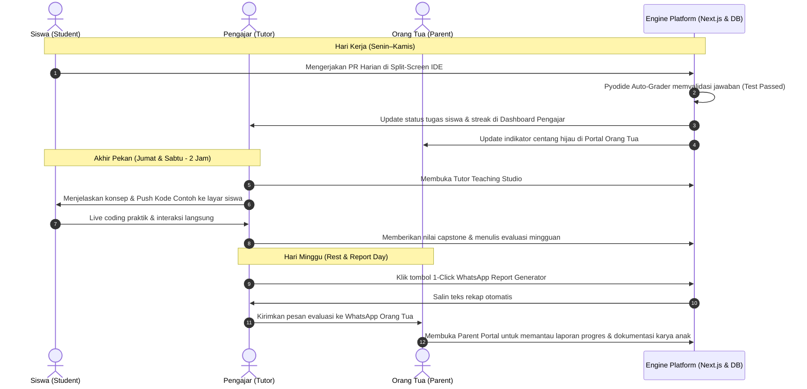

# PRODUCT REQUIREMENT DOCUMENT (PRD)

| **Project Name** | **Platform Edukasi Koding Les Private 1-on-1 (Python Track)** |
|------------------|---------------------------------------------------------------|
| **Document Version** | `v2.1.0 (Detailed Role Panels & Page Architecture)` |
| **Status** | `Ready for Development` |
| **Author / Role** | Global Project Orchestrator & Technical Product Manager |
| **Model Pembelajaran** | Les Private Intensif 1-on-1 (Siswa + Pengajar + Panel Orang Tua) |
| **Primary Stack** | Next.js, Monaco Editor, Pyodide (WebAssembly), PostgreSQL |

---

## 1. Executive Summary & Visi Produk

### 1.1 Visi
Membangun platform sistem pembelajaran koding privat (*1-on-1 private tutoring*) terpadu untuk pemula, yang menghubungkan secara harmonis tiga pihak utama:
1. **Siswa:** Belajar dengan antarmuka interaktif yang mudah, menyenangkan, tanpa instalasi (*zero-setup*), dan ramah kesalahan.
2. **Pengajar (Tutor):** Memiliki *Teaching Console* yang memudahkan penyampaian materi langkah-demi-langkah, kontrol rilis tugas, inspeksi kode langsung, dan evaluasi instan.
3. **Orang Tua (Parents):** Memiliki portal transparansi khusus untuk memantau perkembangan belajar anak, absensi, catatan perkembangan mingguan, serta rekap kemajuan otomatis.

### 1.2 Masalah Utama & Solusi

| Masalah yang Sering Terjadi | Solusi di Platform Ini |
|---|---|
| **Pengajar repot menyiapkan & mengoreksi materi:** Pengajar harus bolak-balik kirim file kode, cek tugas manual, dan menyusun laporan untuk orang tua. | **Tutor Teaching Studio:** Materi terstruktur siap ajar per slide/modul, *live code inspector*, *auto-grader* PR harian, dan tombol 1-klik generate laporan WhatsApp untuk orang tua. |
| **Orang tua tidak tahu progres nyata anak:** Orang tua hanya membayar les tanpa tahu apakah anak benar-benar paham logika koding atau hanya mengetik ulang. | **Parent Monitoring Portal:** Dashboard orang tua untuk memantau persentase materi, streak tugas harian, nilai tugas, dan catatan evaluasi kualitatif dari pengajar. |
| **Siswa pemula takut salah dan malas buka tools rumit:** Instalasi aplikasi koding sering error dan pesan error compiler menakutkan. | **In-Browser Split-Screen & Pyodide:** Langsung koding di browser dengan *Friendly Error Translator* yang ramah dan suportif bagi anak/pemula. |

---

## 2. Struktur Tiga Peran Pengguna (The 3 Core Actors)

```
                     +---------------------------------------+
                     |           PENGAJAR (TUTOR)            |
                     | • Tutor Teaching Studio               |
                     | • Push Code Contoh 1-Klik             |
                     | • Auto-Laporan Rapor WhatsApp Ortu    |
                     +-------------------+-------------------+
                                         |
                       Membimbing &      | Mengirim Rekap
                       Rilis Tugas       | & Evaluasi
                                         v
+------------------------------------+       +------------------------------------+
|           SISWA (STUDENT)          |       |        ORANG TUA (PARENTS)         |
| • Split-Screen Learning Studio     |       | • Parent Monitoring Portal         |
| • Zero-Install Python Sandbox      |       | • Real-time Progress & Daily Streak|
| • PR Harian (Recall, Read, Debug)  |       | • Catatan Perkembangan Anak        |
| • Friendly Error Guidance          |       | • Jadwal Les & Riwayat Pembayaran  |
+------------------------------------+       +------------------------------------+
```

### 1. Siswa (Student - Les Private 1 Orang)
- Belajar mandiri 15–20 menit di hari kerja (Senin–Kamis).
- Mengikuti sesi les privat tatap muka langsung 2 jam bersama pengajar di akhir pekan (Jumat & Sabtu).
- Memperoleh feedback langsung dan perayaan reward (*streak* & sertifikat).

### 2. Pengajar (Tutor / Anda)
- Mengontrol alur pembelajaran melalui *Teaching Console*.
- Menampilkan materi terpandu (*guided slides + interactive code templates*).
- Menilai tugas dengan 1-klik dan memberikan catatan kualitatif mingguan.
- Mengirimkan laporan perkembangan anak ke WhatsApp orang tua dengan format rapi.

### 3. Orang Tua (Parent Portal - Read-Only Monitoring)
- Menerima link/akses login khusus portal pemantauan orang tua (mudah dibuka via smartphone).
- **Hak Akses Murni Memantau (View-Only):** Orang tua hanya memantau progres belajar anak, nilai PR harian, kepatuhan streak, absensi sesi les 2 jam, dan catatan evaluasi dari pengajar.
- **Tidak Memiliki Akses Menjalankan Kode:** Orang tua tidak memiliki terminal/editor dan tidak bisa mencoba/menjalankan kode anak, melainkan hanya melihat laporan dan dokumentasi hasil karya anak yang telah dinilai tuntas oleh pengajar.

---

## 3. Alur Siklus Belajar & Les Privat (Weekly Routine)

```
+------------------------------------------------------------------------------------+
|                                SIKLUS MINGGUAN                                      |
+-------------------+-------------------+-------------------+------------------------+
| Senin             | Selasa            | Rabu              | Kamis                  |
| PR 1: RECALL      | PR 2: CODE READ   | PR 3: DEBUGGING   | PR 4: PRE-READ & MINI  |
| Review materi les | Tebak output      | Perbaiki kode     | Pemanasan teori untuk  |
| akhir pekan lalu  | tanpa mengetik    | yang sengaja rusak| sesi privat Jumat      |
| (~15 menit)       | (~15 menit)       | (~20 menit)       | (~20 menit)            |
+-------------------+-------------------+-------------------+------------------------+
| Jumat             | Sabtu             | Minggu                                     |
| LES PRIVAT 1      | LES PRIVAT 2      | REST & REPORT DAY                          |
| (Tatap Muka 1-on-1| (Tatap Muka 1-on-1| Hari istirahat siswa. Rekap rapor          |
| Langsung 2 Jam)   | Langsung 2 Jam)   | mingguan otomatis terbit ke Portal         |
| Kupas konsep baru | Studi kasus, bedah| Orang Tua & siap dikirim via WhatsApp.     |
| & live coding     | proyek & praktik  |                                            |
| terpandu          | mandiri siswa     |                                            |
+-------------------+-------------------+-------------------+------------------------+
```

---

## 4. Rincian Panel Peran & Arsitektur Halaman (Role Panels & Page Architecture)

### 4.1 Hirarki Navigasi & Struktur Rute URL (Information Architecture)

```
/ (Halaman Utama / Login Portal: Siswa, Pengajar, Orang Tua)
│
├── /student/ (Panel Siswa)
│   ├── /student/dashboard          --> Beranda belajar, ringkasan roadmap 12 minggu, tombol "Mulai PR Hari Ini"
│   ├── /student/learn/[week]/[day] --> Split-Screen Learning Studio (Materi Teori/Video + Monaco Code Editor + Pyodide Console)
│   ├── /student/assignments        --> Daftar riwayat tugas harian Senin-Kamis & status kelulusan (Passed/Review)
│   ├── /student/capstone/[id]      --> Halaman pengerjaan & pengumpulan proyek besar (M4, M8, M12)
│   └── /student/profile            --> Statistik belajar, streak harian, koleksi lencana (badges), & sertifikat kelulusan
│
├── /tutor/ (Panel Pengajar / Anda)
│   ├── /tutor/dashboard            --> Command Center: Status belajar siswa, alert PR belum selesai, jadwal les 2 jam berikutnya
│   ├── /tutor/studio/[week]/[day]  --> Tutor Teaching Studio: Mode presentasi per langkah, Push Code ke siswa, Live Code Viewer
│   ├── /tutor/grading              --> Meja Penilaian: Verifikasi tugas harian, input skor, dan form catatan evaluasi mingguan
│   ├── /tutor/reports              --> 1-Click WhatsApp Report Generator: Pembuat format pesan rekap rapor mingguan orang tua
│   └── /tutor/curriculum           --> Manajemen Modul: CMS pengeditan Markdown teori, kode contoh, dan assertion test cases
│
└── /parent/ (Panel Orang Tua Murid - Mobile-First Read-Only)
    ├── /parent/overview            --> Beranda Orang Tua: Diagram progres 12 minggu, kalender PR Senin-Kamis, status sesi les
    ├── /parent/reports             --> Riwayat Rapor Mingguan & kumpulan catatan kualitatif pengajar per pekan
    ├── /parent/showcase            --> Dokumentasi Karya Anak: Tinjauan deskripsi, status kelulusan, dan foto/preview hasil program anak (View-Only)
    └── /parent/schedule            --> Jadwal Pertemuan Les 2 Jam Jumat-Sabtu & riwayat kehadiran anak
```

---

### 4.2 Arsitektur Tata Letak Panel Siswa (Student Learning Studio)

```
+-----------------------------------------------------------------------------------------+
| [Header] Logo Les | Modul 3: Operator Aritmatika | 🔥 Streak: 5 Hari | Profil Siswa     |
+--------------------------------------------+--------------------------------------------+
| PANEL KIRI (Materi & Panduan)              | PANEL KANAN (Workspace Koding Siswa)       |
| [ Tab 1: Video/Animasi ] [ Tab 2: Teori ]  | [ Monaco Code Editor - Python ]            |
| [ Tab 3: Soal Tantangan Hari Ini ]         | 1  # Buat variabel panjang & lebar         |
|                                            | 2  panjang = 10                            |
| Konten Teori (Markdown Formatted):         | 3  lebar = 5                               |
| Komputer menghitung perkalian menggunakan  | 4  luas = panjang * lebar                  |
| simbol bintang (*).                        | 5  print(f"Luas: {luas}")                  |
|                                            |                                            |
| Soal Praktik:                              | +----------------------------------------+ |
| Hitung luas persegi panjang dengan panjang | | [▶ Jalankan Kode]   [✓ Kumpulkan Tugas]| |
| 10 dan lebar 5, lalu cetak hasilnya!       | +----------------------------------------+ |
|                                            | TERMINAL OUTPUT / CONSOLE (Pyodide WASM)   |
| [💡 Butuh Petunjuk?] (Hint 1 -> Hint 2)    | >> Luas: 50                                |
|                                            | [Status: All Tests Passed! 🎉 +20 XP]     |
+--------------------------------------------+--------------------------------------------+
```

---

### 4.3 Arsitektur Tata Letak Panel Pengajar (Tutor Teaching Studio)

```
+-----------------------------------------------------------------------------------------+
| [Tutor Bar] Sesi Les Privat 1-on-1 | Siswa: Andi | Sisa Waktu: 01:45:00 (Sesi 2 Jam)    |
+--------------------------------------------+--------------------------------------------+
| ALUR MENGAJAR TERPANDU (TEACHING FLOW)     | KONTROL KODE & LIVE MONITOR SISWA          |
| [ Langkah 1: Konsep ]                      | [ Editor Kode Peraga Pengajar ]            |
| Penjelasan konsep logika if-else           | def cek_kelulusan(nilai):                  |
| menggunakan analogi lampu lalu lintas.     |     if nilai >= 75:                        |
|                                            |         return "Lulus"                     |
| [ Langkah 2: Kode Contoh ]                 |     return "Remedial"                      |
| Demonstrasi fungsi return nilai.           |                                            |
|                                            | [ 🚀 PUSH KODE KE EDITOR SISWA ]           |
| [ Langkah 3: Latihan Siswa ]               | ------------------------------------------ |
| Siswa mencoba membuat penentu nilai rapor. | LIVE VIEW LAYAR KODE SISWA:                |
|                                            | Status: Sedang Mengetik Baris 4...         |
| ------------------------------------------ | Output Siswa: >> Lulus                     |
| [ ⭐ Beri Bintang Apresiasi ]              |                                            |
| [ 📝 Tulis Catatan Nalar untuk Ortu ]      | [ ✅ TANDAI MATERI INI SELESAI ]           |
+--------------------------------------------+--------------------------------------------+
```

---

### 4.4 Arsitektur Tata Letak Panel Orang Tua (Parent Monitoring Portal - Mobile View)

```
+-------------------------------------------------------------+
| 📱 PANEL ORANG TUA: LAPORAN BELAJAR KODING                  |
| Siswa: Andi Pratama | Pengajar: Kak Tutor | Batch Private 1 |
+-------------------------------------------------------------+
| 📊 KEMAJUAN BELAJAR 12 MINGGU                               |
| [==== 35% Selesai (Minggu ke-4 dari 12) ==================] |
| Status: Menguasai Variabel, Percabangan, & Perulangan Dasar |
+-------------------------------------------------------------+
| 📅 KONSISTENSI PR HARIAN MINGGU INI                         |
| • Senin  (PR 1 - Recall):       [ ✅ Selesai | Nilai: 100 ] |
| • Selasa (PR 2 - Code Reading): [ ✅ Selesai | Nilai: 90  ] |
| • Rabu   (PR 3 - Debugging):    [ ✅ Selesai | Nilai: 95  ] |
| • Kamis  (PR 4 - Pre-read):     [ ✅ Selesai | Nilai: 100 ] |
| 🔥 Streak Belajar: 4 Hari Berturut-turut!                   |
+-------------------------------------------------------------+
| 🌟 CATATAN PERKEMBANGAN DARI PENGAJAR (PEKAN INI)           |
| "Andi memiliki daya tangkap logika yang sangat kuat pada    |
| materi if-else. Nalar berpikir analitisnya berkembang pesat,|
| dan ia sangat antusias saat berhasil membuat game tebak     |
| angka sendiri."                                             |
+-------------------------------------------------------------+
| 📁 DOKUMENTASI HASIL KARYA ANAK (READ-ONLY MONITORING)       |
| • Capstone 1: Game Tebak Angka CLI       [ Status: TUNTAS ] |
| • Latihan: Kalkulator Sederhana          [ Status: TUNTAS ] |
+-------------------------------------------------------------+
| ⏰ JADWAL PERTEMUAN LANGSUNG (2 JAM)                        |
| • Jumat, 16.00 - 18.00 WIB: [ ✅ Hadir ]                    |
| • Sabtu, 16.00 - 18.00 WIB: [ ⏳ Sesi Berikutnya ]          |
+-------------------------------------------------------------+
```

---

## 5. Sinkronisasi Data Lintas Peran (Cross-Role Data Flow)



---

## 6. Peta Kurikulum 12 Minggu (Python Track Private)

### Fase 1: Fondasi Logika & Komputasi Dasar (Bulan 1)
- **Minggu 1:** Berkenalan dengan Dunia Komputer, Fungsi `print()`, Variabel & Tipe Data.
- **Minggu 2:** Operator Aritmatika & Pengambilan Keputusan (`if-elif-else`).
- **Minggu 3:** Perulangan (`for` / `while loop`) & Struktur Data List Dasar.
- **Minggu 4: Capstone Proyek 1:** Game Tebak Angka / Batu-Gunting-Kertas / Interactive To-Do List. *(Siswa mempresentasikan hasil ke orang tua & pengajar)*.

### Fase 2: Menengah, Pemecahan Masalah & Struktur Data (Bulan 2)
- **Minggu 5:** Struktur Data Lanjutan: Dictionary (Key-Value) & Tuples (Sistem Kasir Mini).
- **Minggu 6:** Error Handling (`try-except`) & Menyimpan Data ke File Disk (`.txt` / `.csv`).
- **Minggu 7:** Berpikir Terstruktur: Object-Oriented Programming Dasar (Class & Object Karakter RPG).
- **Minggu 8: Capstone Proyek 2:** Aplikasi Konsol Buku Kontak Lengkap (CRUD + Simpan File Permanen).

### Fase 3: Terapan Nyata & Kelulusan (Bulan 3)
- **Minggu 9:** Menghubungkan Kode ke Internet: HTTP API & JSON (Aplikasi Cuaca / Kurs Valas).
- **Minggu 10:** Tampilan Visual: Mengubah Script Konsol menjadi Web App Interaktif (Streamlit / UI).
- **Minggu 11:** Pengerjaan Proyek Akhir Pilihan Siswa & Sesi Bimbingan Intensif.
- **Minggu 12: DEMO DAY KELUARGA:** Siswa mendemonstrasikan aplikasi web buatannya di depan orang tua & pengajar, penyerahan E-Sertifikat Kelulusan resmi.

---

## 7. Rincian Silabus & Aktivitas 24 Pertemuan Langsung (Tatap Muka 2 Jam)

Setiap pekan terdiri dari 2 sesi tatap muka langsung (Jumat & Sabtu), masing-masing berdurasi **2 Jam (120 Menit)**. Total terdapat **24 Pertemuan Langsung** selama program 12 minggu.

### 7.1 Alur Standar Sesi Mengajar 2 Jam (120 Menit)
```
+------------------------------------------------------------------------------------+
|                             ALUR SESI 2 JAM (120 MENIT)                            |
+-------------------+-------------------+-------------------+------------------------+
| 00:00 - 00:25     | 00:25 - 01:10     | 01:10 - 01:50     | 01:50 - 02:00          |
| (25 Menit)        | (45 Menit)        | (40 Menit)        | (10 Menit)             |
| REVIEW & PEMANASAN| KONSEP & LIVE DEMO| PRAKTIK TERPANDU  | REFLEKSI & CATATAN ORTU|
| Evaluasi PR harian| Tutor demonstrasi | Siswa koding kasus| Tutor beri feedback &  |
| Senin–Kamis & tanya| materi baru via   | nyata; tutor pantau| input catatan rapor   |
| kendala siswa     | Teaching Studio   | via Live Inspector| mingguan untuk ortu    |
+-------------------+-------------------+-------------------+------------------------+
```

### 7.2 Penjelasan Rinci Setiap Pertemuan Pembelajaran (24 Sesi Langsung @ 2 Jam)

Berikut adalah rincian materi, alur aktivitas pembelajaran terpandu selama 2 jam, serta output nyata yang dihasilkan siswa untuk setiap sesi tatap muka langsung. Disusun secara **editorial naratif per bagian (bukan dalam bentuk tabel dan bukan dalam bentuk card/box)** guna menjaga keterbacaan dokumen 1 kolom yang bersih, lugas, dan terstruktur:

---

#### Fase 1: Fondasi Logika & Komputasi Dasar (Pertemuan 1 s.d 8)

##### Pertemuan 1: Logika Komputer, IPO & Fungsi print()
- **Jadwal:** Minggu 1, Hari Jumat (Sesi Tatap Muka Langsung 2 Jam)
- **Topik Utama:** Cara kerja komputer membaca instruksi (Input-Proses-Output), aturan sintaksis dasar Python, dan pencetakan teks dengan `print()`.
- **Aktivitas Belajar 2 Jam:**
  - *25 Mnt:* Pengenalan antarmuka Split-Screen IDE dan simulasi nalar bagaimana komputer memproses data.
  - *45 Mnt:* Pengajar mendemonstrasikan fungsi `print()`, penggunaan tanda kutip string, escape character (`\n`, `\t`), dan seni teks ASCII.
  - *40 Mnt:* Siswa praktik membuat kartu identitas digital berformat rapi di konsol.
  - *10 Mnt:* Evaluasi kode siswa dan pengajar menulis catatan pertama untuk orang tua.
- **Output Nyata Siswa:** Program Kartu Biodata Diri Digital di Terminal Konsol.

##### Pertemuan 2: Kotak Memori: Variabel & Tipe Data Dasar
- **Jadwal:** Minggu 1, Hari Sabtu (Sesi Tatap Muka Langsung 2 Jam)
- **Topik Utama:** Konsep variabel sebagai wadah berlabel di memori serta tipe data dasar (`str`, `int`, `float`, `bool`).
- **Aktivitas Belajar 2 Jam:**
  - *25 Mnt:* Review PR Hari Kamis dan evaluasi kesalahan penamaan variabel.
  - *45 Mnt:* Pengajar mendemonstrasikan aturan penamaan variabel, penugasan nilai (`=`), dan pengenalan fungsi `input()`.
  - *40 Mnt:* Siswa membuat formulir interaktif yang menerima nama dan tahun lahir, lalu menghitung umur secara otomatis.
  - *10 Mnt:* Pengajar memberikan bintang apresiasi dan mencatat pemahaman tipe data siswa.
- **Output Nyata Siswa:** Formulir Pendaftaran Dinamis & Penghitung Umur Otomatis.

##### Pertemuan 3: Otak Berhitung: Operator Aritmatika & Modulo (%)
- **Jadwal:** Minggu 2, Hari Jumat (Sesi Tatap Muka Langsung 2 Jam)
- **Topik Utama:** Operasi kalkulasi matematika (`+`, `-`, `*`, `/`, `//`), konversi tipe data (`int()`, `str()`), dan operasi sisa bagi modulo (`%`).
- **Aktivitas Belajar 2 Jam:**
  - *25 Mnt:* Membahas kendala PR debugging Rabu dan latihan tebak hasil aritmatika.
  - *45 Mnt:* Pengajar menjelaskan urutan operasi matematika (*PEMDAS*) di Python dan rahasia kegunaan modulo (ganjil-genap dan konversi waktu).
  - *40 Mnt:* Siswa memprogram kalkulator luas bangun datar dan konverter total menit ke format jam-menit.
  - *10 Mnt:* Pengajar mencatat kemajuan nalar matematis siswa ke portal rapor.
- **Output Nyata Siswa:** Program Kalkulator Luas Bangun Datar & Konverter Waktu.

##### Pertemuan 4: Komputer Mengambil Keputusan: Percabangan if-elif-else
- **Jadwal:** Minggu 2, Hari Sabtu (Sesi Tatap Muka Langsung 2 Jam)
- **Topik Utama:** Logika percabangan syarat (`if`, `elif`, `else`), operator perbandingan (`>`, `<`, `==`, `!=`), dan operator logika (`and`, `or`).
- **Aktivitas Belajar 2 Jam:**
  - *25 Mnt:* Review PR pre-read Kamis tentang alur flowchart keputusan.
  - *45 Mnt:* Pengajar mendemonstrasikan analogi lampu lalu lintas dan validasi kelayakan SIM/KTP.
  - *40 Mnt:* Siswa membangun logika seleksi penentu grade nilai ujian (A, B, C, D) berdasarkan rentang skor input.
  - *10 Mnt:* Pengajar menguji kasus uji (*edge cases*) kode siswa dan input catatan orang tua.
- **Output Nyata Siswa:** Program Penyeleksi Kelayakan Umur KTP & Penentu Grade Nilai Rapor.

##### Pertemuan 5: Otomatisasi Perulangan: for loop & range()
- **Jadwal:** Minggu 3, Hari Jumat (Sesi Tatap Muka Langsung 2 Jam)
- **Topik Utama:** Pengulangan tugas tanpa henti dengan `for loop`, parameter fungsi `range(start, stop, step)`.
- **Aktivitas Belajar 2 Jam:**
  - *25 Mnt:* Review PR recall logika percabangan akhir pekan lalu.
  - *45 Mnt:* Pengajar mendemonstrasikan bagaimana 3 baris kode loop dapat menggantikan 100 baris kode print manual.
  - *40 Mnt:* Siswa membuat program hitung mundur roket peluncuran luar angkasa dan tabel perkalian dinamis 1 sampai 10.
  - *10 Mnt:* Refleksi sesi dan pengecekan streak harian siswa.
- **Output Nyata Siswa:** Program Roket Hitung Mundur Luar Angkasa & Tabel Perkalian Otomatis.

##### Pertemuan 6: Lemari Penyimpanan Data: Struktur Data List
- **Jadwal:** Minggu 3, Hari Sabtu (Sesi Tatap Muka Langsung 2 Jam)
- **Topik Utama:** Menyimpan banyak data dalam 1 variabel menggunakan `list`, indeks urutan (mulai dari 0), method `append()`, `remove()`, dan fungsi `len()`.
- **Aktivitas Belajar 2 Jam:**
  - *25 Mnt:* Pemanasan logika menebak indeks elemen list.
  - *45 Mnt:* Pengajar mendemonstrasikan manipulasi list belanja dan perulangan `for item in list`.
  - *40 Mnt:* Siswa membuat program daftar belanja interaktif yang bisa menambah barang, menghapus barang, dan mencetak seluruh isi daftar.
  - *10 Mnt:* Pengajar memberi nilai PR pekan ke-3 dan mengisi catatan untuk orang tua.
- **Output Nyata Siswa:** Aplikasi Daftar Belanja Interaktif & Penghitung Total Barang.

##### Pertemuan 7: Membuat Mesin Mandiri: Fungsi Modular (def & return)
- **Jadwal:** Minggu 4, Hari Jumat (Sesi Tatap Muka Langsung 2 Jam)
- **Topik Utama:** Prinsip Clean Code, modularitas program, mendefinisikan fungsi (`def`), parameter/argumen, dan mengembalikan hasil dengan `return`.
- **Aktivitas Belajar 2 Jam:**
  - *25 Mnt:* Evaluasi PR debugging hari Rabu mengenai scope variabel lokal vs global.
  - *45 Mnt:* Pengajar mengibaratkan fungsi sebagai mesin jus (masukkan buah ➔ keluar jus) dan demonstrasi refactoring kode.
  - *40 Mnt:* Siswa merombak kalkulator sebelumnya menjadi kumpulan fungsi terpisah (`tambah()`, `kurang()`, `kali()`, `bagi()`).
  - *10 Mnt:* Persiapan briefing pengerjaan Proyek Capstone 1 untuk sesi Sabtu.
- **Output Nyata Siswa:** Kalkulator Multifungsi Berbasis Fungsi Modular Bersih.

##### Pertemuan 8: Eksekusi Capstone 1: Game CLI Interaktif
- **Jadwal:** Minggu 4, Hari Sabtu (Sesi Tatap Muka Langsung 2 Jam)
- **Topik Utama:** Mengintegrasikan seluruh materi Bulan 1 (Variabel, If-Else, Loop, List, dan Fungsi) dengan modul `random`.
- **Aktivitas Belajar 2 Jam:**
  - *25 Mnt:* Review alur logika game dan pengundian modul `random.choice()`.
  - *45 Mnt:* Bimbingan langsung pembuatan kerangka Game Tebak Angka Rahasia / Batu-Gunting-Kertas melawan komputer.
  - *40 Mnt:* Siswa mengoding mandiri penambahan sistem skor, ronde permainan, dan penentu kemenangan akhir.
  - *10 Mnt:* Pengajar menguji game siswa, memberikan sertifikat milestone Fase 1, dan membuat rekap laporan bulanan pertama untuk orang tua.
- **Output Nyata Siswa:** **Karya 1:** Game Tebak Angka / Batu-Gunting-Kertas Lengkap dengan Skor.

---

#### Fase 2: Menengah, Pemecahan Masalah & Struktur Data (Pertemuan 9 s.d 16)

##### Pertemuan 9: Kamus Data: Dictionary (Key-Value) & Tuples
- **Jadwal:** Minggu 5, Hari Jumat (Sesi Tatap Muka Langsung 2 Jam)
- **Topik Utama:** Struktur data berpasangan `key: value`, pencarian data secepat kilat via key, dan perbedaan data permanen `tuple`.
- **Aktivitas Belajar 2 Jam:**
  - *25 Mnt:* Review pengerjaan Capstone 1 dan pengenalan konsep kamus.
  - *45 Mnt:* Pengajar mendemonstrasikan pembuatan profil objek game dengan dictionary (misal: nama, darah, senjata).
  - *40 Mnt:* Siswa membuat program basis data profil hero RPG yang bisa di-update datanya via input konsol.
  - *10 Mnt:* Pengajar mencatat pemahaman konsep key-value siswa.
- **Output Nyata Siswa:** Database Profil Karakter Game RPG Interaktif.

##### Pertemuan 10: Manajemen Data Majemuk: List of Dictionaries
- **Jadwal:** Minggu 5, Hari Sabtu (Sesi Tatap Muka Langsung 2 Jam)
- **Topik Utama:** Menggabungkan struktur data majemuk (kumpulan kamus di dalam list) untuk mensimulasikan sistem inventaris nyata.
- **Aktivitas Belajar 2 Jam:**
  - *25 Mnt:* Pemanasan membaca data berstruktur JSON sederhana.
  - *45 Mnt:* Pengajar mencontohkan daftar produk toko mini (nama barang, harga, stok) dan perulangan kalkulasi belanja.
  - *40 Mnt:* Siswa membuat sistem kasir toko mini yang menghitung total belanjaan dan mencetak struk belanja rapi.
  - *10 Mnt:* Pengajar mengisi formulir laporan WhatsApp orang tua.
- **Output Nyata Siswa:** Sistem Kasir Toko Mini & Cetak Struk Belanja Otomatis.

##### Pertemuan 11: Program Anti-Crash: Error Handling (try-except)
- **Jadwal:** Minggu 6, Hari Jumat (Sesi Tatap Muka Langsung 2 Jam)
- **Topik Utama:** Mengantisipasi kegagalan sistem dengan blok `try`, `except`, dan `finally` (`ValueError`, `ZeroDivisionError`).
- **Aktivitas Belajar 2 Jam:**
  - *25 Mnt:* Bedah kasus mengapa aplikasi perbankan atau game bisa force-close (crash) saat salah input.
  - *45 Mnt:* Pengajar mengajarkan teknik membentengi kode agar tetap berjalan stabil meski pengguna memasukkan huruf di kolom angka.
  - *40 Mnt:* Siswa membentengi kalkulator dan sistem kasir sebelumnya agar 100% kebal dari input rusak.
  - *10 Mnt:* Pengajar menguji ketahanan kode siswa dengan berbagai input ekstrim.
- **Output Nyata Siswa:** Program Kalkulator Kebal Crash dari Input Rusak / Pembagian Nol.

##### Pertemuan 12: Menyimpan Data Permanen: File I/O (.txt & .csv)
- **Jadwal:** Minggu 6, Hari Sabtu (Sesi Tatap Muka Langsung 2 Jam)
- **Topik Utama:** Mengakses sistem file disk komputer menggunakan fungsi `open()`, mode tulis (`w`), baca (`r`), dan tambah (`a`).
- **Aktivitas Belajar 2 Jam:**
  - *25 Mnt:* Menjelaskan batas memori RAM (hilang saat aplikasi ditutup) vs Harddisk (permanen).
  - *45 Mnt:* Pengajar mendemonstrasikan cara menulis data string siswa ke file `.txt` dan membaca kembali baris per baris.
  - *40 Mnt:* Siswa membuat aplikasi buku harian mini yang menyimpan catatan harian ke file teks permanen di komputer.
  - *10 Mnt:* Verifikasi file yang terbentuk di storage dan input rekap rapor orang tua.
- **Output Nyata Siswa:** Aplikasi Buku Catatan Harian Tersimpan Permanen di File Disk.

##### Pertemuan 13: Berpikir Seperti Arsitek: Pengenalan OOP (Class & Object)
- **Jadwal:** Minggu 7, Hari Jumat (Sesi Tatap Muka Langsung 2 Jam)
- **Topik Utama:** Konsep Object-Oriented Programming (OOP): Cetak biru (`class`), pembuatan wujud nyata (`object`), konstruktor `__init__`, dan atribut.
- **Aktivitas Belajar 2 Jam:**
  - *25 Mnt:* Pemanasan analogi dunia nyata (Cetak biru rumah vs Rumah fisik yang sudah dibangun).
  - *45 Mnt:* Pengajar memandu pembuatan Class Mobil dengan atribut merk, warna, dan kecepatan.
  - *40 Mnt:* Siswa membuat Class Hewan Peliharaan dan Class Mobil dengan method aksi `maju()` dan `rem()`.
  - *10 Mnt:* Pengajar mengevaluasi pemahaman nalar abstraksi OOP siswa.
- **Output Nyata Siswa:** Program Simulasi Garasi Mobil Berbasis Class & Object.

##### Pertemuan 14: Interaksi Antar Objek dalam OOP: Method & Turn-Based Duel
- **Jadwal:** Minggu 7, Hari Sabtu (Sesi Tatap Muka Langsung 2 Jam)
- **Topik Utama:** Method interaktif yang memanipulasi atribut objek lain (interaksi antar instance).
- **Aktivitas Belajar 2 Jam:**
  - *25 Mnt:* Review pembuatan method dan passing parameter objek.
  - *45 Mnt:* Pengajar mendemonstrasikan interaksi Class Hero dan Class Monster di mana `hero.serang(monster)` mengurangi HP monster.
  - *40 Mnt:* Siswa memprogram game pertarungan RPG mini berbasis giliran giliran (*turn-based battle*) di konsol.
  - *10 Mnt:* Pengajar menguji duel karakter buatan siswa dan input laporan mingguan.
- **Output Nyata Siswa:** Mini Game Pertarungan RPG Berbasis OOP (Hero vs Monster).

##### Pertemuan 15: Desain Arsitektur CRUD Konsol Berulang (while True)
- **Jadwal:** Minggu 8, Hari Jumat (Sesi Tatap Muka Langsung 2 Jam)
- **Topik Utama:** Merancang antarmuka menu konsol interaktif profesional yang tidak langsung tertutup menggunakan loop `while True`.
- **Aktivitas Belajar 2 Jam:**
  - *25 Mnt:* Menelaah struktur menu aplikasi: 1. Tambah Data, 2. Lihat Semua, 3. Cari Data, 4. Hapus, 5. Keluar.
  - *45 Mnt:* Pengajar membimbing perancangan kerangka kerja modular sistem buku kontak telepon.
  - *40 Mnt:* Siswa mengimplementasikan fungsi pencarian nama kontak dan penanganan input menu salah.
  - *10 Mnt:* Pengajar mereview arsitektur kode siswa sebelum finalisasi Capstone 2 di sesi Sabtu.
- **Output Nyata Siswa:** Kerangka Sistem Aplikasi Buku Kontak Mandiri.

##### Pertemuan 16: Eksekusi Capstone 2: Buku Kontak CRUD + Penyimpanan File CSV
- **Jadwal:** Minggu 8, Hari Sabtu (Sesi Tatap Muka Langsung 2 Jam)
- **Topik Utama:** Menyatukan OOP, menu CRUD lengkap, penanganan error, dan persistensi file disk `.csv`.
- **Aktivitas Belajar 2 Jam:**
  - *25 Mnt:* Review alur baca-tulis file CSV (format tabel teks dengan pemisah koma).
  - *45 Mnt:* Siswa mengintegrasikan penyimpanan kontak agar tidak hilang saat program ditutup dan dibuka kembali.
  - *40 Mnt:* Siswa melakukan uji coba menyeluruh: tambah kontak teman, cari nomor HP, dan edit data.
  - *10 Mnt:* Pengajar memberikan penilaian Capstone 2, menerbitkan lencana Fase 2, dan menyusun laporan tengah semester untuk orang tua.
- **Output Nyata Siswa:** **Karya 2:** Aplikasi Konsol Buku Kontak Lengkap + Penyimpanan File CSV Permanen.

---

#### Fase 3: Terapan Nyata, Web App & Kelulusan (Pertemuan 17 s.d 24)

##### Pertemuan 17: Menghubungkan Kode ke Internet: API & JSON
- **Jadwal:** Minggu 9, Hari Jumat (Sesi Tatap Muka Langsung 2 Jam)
- **Topik Utama:** Konsep bagaimana aplikasi modern berkomunikasi melalui internet (Client-Server, HTTP GET Request, pustaka `requests`, dan parsing data JSON).
- **Aktivitas Belajar 2 Jam:**
  - *25 Mnt:* Simulasi nalar analogi kurir pengantar data (API) dari server ke laptop siswa.
  - *45 Mnt:* Pengajar mendemonstrasikan cara menembak endpoint API publik untuk mengambil kutipan inspiratif / fakta unik acak.
  - *40 Mnt:* Siswa membuat program Python yang otomatis mengambil dan mencetak fakta unik dari internet setiap kali dijalankan.
  - *10 Mnt:* Pengajar mengevaluasi pemahaman konsep web data siswa.
- **Output Nyata Siswa:** Program Pengambil Fakta Unik / Quotes Inspiratif Otomatis dari Internet.

##### Pertemuan 18: Proyek Data Real-Time: API Cuaca Kota & Kurs Valuta Asing
- **Jadwal:** Minggu 9, Hari Sabtu (Sesi Tatap Muka Langsung 2 Jam)
- **Topik Utama:** Mengambil data dunia nyata yang berubah secara dinamis (Live Weather Data & Currency Exchange Rates).
- **Aktivitas Belajar 2 Jam:**
  - *25 Mnt:* Pemanasan membaca struktur dictionary bersarang (*nested JSON*) dari API cuaca.
  - *45 Mnt:* Pengajar memandu ekstraksi parameter suhu, kelembapan, dan kondisi cuaca berdasarkan nama kota inputan siswa.
  - *40 Mnt:* Siswa membangun aplikasi konsol pengecek cuaca kota dan konverter kurs mata uang Dollar ke Rupiah real-time.
  - *10 Mnt:* Pengajar menguji akurasi data dan mengirim rekap laporan mingguan ke orang tua.
- **Output Nyata Siswa:** Aplikasi Pengecek Cuaca Kota & Konverter Kurs Valas Real-Time.

##### Pertemuan 19: Tampilan Visual Modern: Pengenalan Streamlit / Web UI
- **Jadwal:** Minggu 10, Hari Jumat (Sesi Tatap Muka Langsung 2 Jam)
- **Topik Utama:** Mentransformasi kode Python dari terminal konsol hitam-putih menjadi halaman web antarmuka visual interaktif (Streamlit).
- **Aktivitas Belajar 2 Jam:**
  - *25 Mnt:* Pengenalan paradigma antarmuka visual (elemen judul, tombol, input teks, dan gambar di browser).
  - *45 Mnt:* Pengajar mendemonstrasikan kemudahan membuat komponen web hanya dengan perintah Python sederhana (`st.title()`, `st.button()`, `st.text_input()`).
  - *40 Mnt:* Siswa membuat halaman web profil diri interaktif yang dilengkapi tombol sapaan dan konverter satuan suhu visual.
  - *10 Mnt:* Pengajar melihat tampilan web perdana siswa dan memberi feedback desain.
- **Output Nyata Siswa:** Web App Biodata Diri & Konverter Satuan Visual Interaktif.

##### Pertemuan 20: Menghubungkan Logika Python ke Dashboard Web UI
- **Jadwal:** Minggu 10, Hari Sabtu (Sesi Tatap Muka Langsung 2 Jam)
- **Topik Utama:** Mengintegrasikan form input web, panggilan API internet, dan visualisasi data tabel/grafik di browser.
- **Aktivitas Belajar 2 Jam:**
  - *25 Mnt:* Review pengerjaan input form di web.
  - *45 Mnt:* Pengajar membimbing transformasi aplikasi cuaca konsol dari Minggu 9 menjadi Dashboard Web Cuaca yang cantik dan berwarna.
  - *40 Mnt:* Siswa menambahkan fitur pemilihan kota via dropdown web dan menampilkan ikon cuaca dinamis.
  - *10 Mnt:* Pengajar menguji coba dashboard web siswa dan mengabari orang tua bahwa anak sudah berhasil membuat web hidup.
- **Output Nyata Siswa:** Web Dashboard Pengecek Cuaca Interaktif Berbasis Browser.

##### Pertemuan 21: Kickoff Final Capstone: Perancangan Proyek Mandiri Pilihan Siswa
- **Jadwal:** Minggu 11, Hari Jumat (Sesi Tatap Muka Langsung 2 Jam)
- **Topik Utama:** Menentukan ide proyek akhir portofolio siswa yang unik (misal: Web Rekomendasi Game, Web Pencatat Keuangan Saku, Web Kuis Trivia Edukasi).
- **Aktivitas Belajar 2 Jam:**
  - *25 Mnt:* Sesi brainstorming ide antara pengajar dan siswa sesuai minat anak.
  - *45 Mnt:* Pengajar memandu penyusunan wireframe sederhana dan pembagian fungsi-fungsi kode yang dibutuhkan.
  - *40 Mnt:* Siswa mulai mengoding kerangka dasar struktur aplikasi web mandirinya.
  - *10 Mnt:* Pengajar memvalidasi kelayakan proyek dan memberi target pengerjaan untuk sesi Sabtu.
- **Output Nyata Siswa:** Dokumen Perencanaan & Kerangka Awal Proyek Web App Portofolio.

##### Pertemuan 22: Debugging Clinic & Polishing Proyek Akhir
- **Jadwal:** Minggu 11, Hari Sabtu (Sesi Tatap Muka Langsung 2 Jam)
- **Topik Utama:** Sesi konsultasi mendalam: eliminasi error bug, optimasi kecepatan, perapian tata letak UI, dan penanganan edge cases.
- **Aktivitas Belajar 2 Jam:**
  - *25 Mnt:* Siswa memaparkan kemajuan koding proyek dan bagian mana yang mengalami kendala/error.
  - *45 Mnt:* Pengajar membantu mendeteksi letak bug logika menggunakan teknik debugging terstruktur tanpa mengambil alih ketikan siswa.
  - *40 Mnt:* Siswa memoles tampilan web, menambah teks petunjuk ramah pengguna, dan memastikan seluruh tombol berfungsi sempurna.
  - *10 Mnt:* Pengajar menyatakan proyek 90% tuntas dan memberikan checklist persiapan Demo Day kelulusan.
- **Output Nyata Siswa:** Proyek Web App Portofolio 90% Tuntas dan Siap Dipresentasikan.

##### Pertemuan 23: Gladi Resik Demo Day: Pengujian Menyeluruh & Latihan Presentasi
- **Jadwal:** Minggu 12, Hari Jumat (Sesi Tatap Muka Langsung 2 Jam)
- **Topik Utama:** Pengujian akhir program (*smoke test*) dan melatih siswa menyampaikan presentasi dengan percaya diri di depan orang tua.
- **Aktivitas Belajar 2 Jam:**
  - *25 Mnt:* Pengujian fungsionalitas web secara menyeluruh dari awal hingga akhir.
  - *45 Mnt:* Pengajar melatih siswa menyusun cerita presentasi: 1. Masalah yang ingin diselesaikan, 2. Cara kerja web app, 3. Kendala tersulit yang berhasil diatasi.
  - *40 Mnt:* Siswa melakukan simulasi presentasi penuh (gladi resik) di hadapan pengajar.
  - *10 Mnt:* Pengajar memberikan catatan polesan kata-kata dan mengirimkan undangan resmi Demo Day ke orang tua untuk hari Sabtu.
- **Output Nyata Siswa:** Slide Presentasi Ringkas & Aplikasi Web 100% Siap Demo.

##### Pertemuan 24: DEMO DAY KELUARGA & KELULUSAN (WISUDA)
- **Jadwal:** Minggu 12, Hari Sabtu (Sesi Tatap Muka Langsung 2 Jam)
- **Topik Utama:** Sidang karya santai: Siswa mendemonstrasikan aplikasi web buatannya di hadapan orang tua dan pengajar, evaluasi nalar logika, dan seremoni kelulusan.
- **Aktivitas Belajar 2 Jam:**
  - *15 Mnt:* Pembukaan oleh pengajar dan sambutan pengantar perjalanan belajar 12 minggu.
  - *45 Mnt:* Siswa mendemonstrasikan aplikasi web buatannya di depan orang tua, menjelaskan alur kode, dan memperlihatkan hasil fungsinya.
  - *30 Mnt:* Sesi apresiasi: Orang tua dan pengajar memberikan komentar positif serta tanya jawab santai seputar karya anak.
  - *30 Mnt:* Pengumuman kelulusan resmi, penyerahan E-Sertifikat Kelulusan digital, dan penutupan program les privat.
- **Output Nyata Siswa:** **Karya 3 Final:** Kelulusan Resmi dengan Portofolio Aplikasi Web Nyata yang Hidup.

---

## 8. Non-Functional Requirements (NFR)

| Kategori | Spesifikasi Target |
|----------|-------------------|
| **Kemudahan Akses** | Siswa dan pengajar tidak perlu install compiler Python lokal. Cukup buka browser. |
| **Responsivitas Panel Ortu** | Panel Orang Tua dirancang *Mobile-First* agar nyaman dibuka lewat smartphone orang tua. |
| **Privasi Data Siswa** | Data siswa, kode, dan nilai bersifat privat dan hanya dapat diakses oleh siswa, pengajar, dan orang tua terkait. |
| **Penyimpanan Draft Kode** | Auto-save draft pengerjaan kode setiap 3 detik ke LocalStorage agar tidak hilang jika koneksi terputus. |

---

## 9. Indikator Keberhasilan (KPI Les Private)

1. **Konsistensi Tugas Harian (PR):** Siswa menyelesaikan minimal 80% tugas harian Senin–Kamis.
2. **Kepuasan Orang Tua (*Parent Trust*):** Orang tua aktif membuka laporan perkembangan anak setiap pekan.
3. **Efisiensi Waktu Pengajar:** Waktu persiapan mengajar dan administrasi laporan berkurang hingga 70%.
4. **Kelulusan Portofolio:** Siswa berhasil menyelesaikan 3 Proyek Capstone (M4, M8, M12) dengan tuntas.

